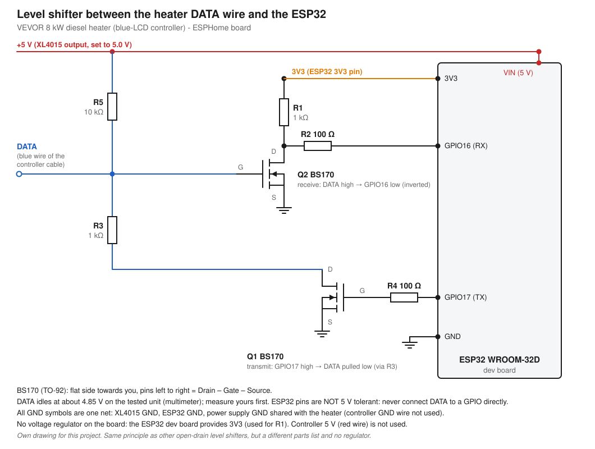
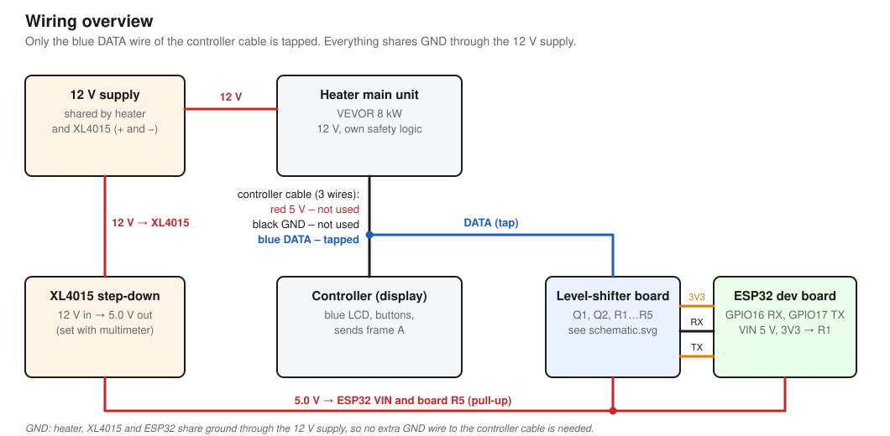

# VEVOR 8-kW-Dieselheizung → ESPHome / Home Assistant

🇬🇧 [English version](README.md)

Lokale Steuerung einer **VEVOR-12-V-Diesel-Luftheizung (8 kW, Kabel-Controller mit blauem LCD)** mit ESP32 und ESPHome: Zustand, Stufe und Versorgungsspannung in Home Assistant sehen, Heizung ein- und ausschalten und die Leistungsstufe (1–6) ändern. Keine Cloud, kein Bluetooth. Der ESP greift die einzelne Datenleitung zwischen Controller und Heizung ab und „drückt die Tasten“ für dich. Der Original-Controller und die Fernbedienung funktionieren weiter.

> ⚠️ **Das steuert ein Gerät, das Brennstoff verbrennt. Lies [docs/safety.de.md](docs/safety.de.md), bevor du etwas baust oder startest.** Nutzung auf eigenes Risiko. Dieses Projekt steht in keiner Verbindung zu VEVOR.



## Passt das zu meiner Heizung?

Wahrscheinlich **nur, wenn sie so aussieht wie diese**. Gebaut und getestet wurde mit genau einem Gerät:

- VEVOR-12-V-Diesel-Luftheizung, als „8 kW“ verkauft
- Kabel-Controller mit **blauem LCD** und den Tasten *hoch, runter, Ein/Aus, Gang (Einstellungen), OK*, angeschlossen über ein **3-adriges Kabel** (rot 5 V, schwarz GND, blau DATA)
- optional eine 433-MHz-Fernbedienung: ihre Befehle erscheinen auf dem Bus als dieselben Frames wie die Controller-Tasten

Diese Heizung spricht **nicht** das 4800-Baud-UART-Protokoll (oder 25000 Baud), das andere Open-Source-Projekte beschreiben. Sie benutzt einen langsamen Pulscode mit 12-ms-Bitzellen, siehe [docs/protocol/protocol.de.md](docs/protocol/protocol.de.md). Bei einer anderen Heizung zeigt der Raw-Capture-Helfer in [`esphome/helpers/`](esphome/helpers/raw-capture.yaml) in wenigen Minuten, ob dasselbe Protokoll läuft. Berichte zu anderen Modellen sind sehr willkommen (siehe *Mitmachen*).

Die gleiche Familie von Pulscode-Heizungen beschreiben auch andere: [kellerman/vevor_pwm](https://github.com/kellerman/vevor_pwm) dokumentiert 8-Bit-Befehle und 16-Bit-Statuswörter mit etwa 12-ms-Zelle für „Vevor PWM“-Heizungen (im [Home-Assistant-Forum](https://community.home-assistant.io/t/vevor-diesel-heater-control-development-in-progress/832159) und in [zatakon/esphome-vevor-heater#2](https://github.com/zatakon/esphome-vevor-heater/issues/2) werden ZM8001 und eine Sunster 8 kW genannt). Ihre Werte stimmen mit denen dieses Projekts überein, wenn man alle Bits invertiert, siehe [Vergleich](docs/protocol/protocol.de.md#vergleich-mit-kellermanvevor_pwm). Diese Firmware wurde unabhängig entwickelt und an diesen Heizungen **nicht** getestet.

## Funktionen

- Zustand: Standby, Start angefordert, Lüfter-Anlauf, Vorglühen, Zündung, Läuft, Abkühlen, Störung
- Leistungsstufe 1–6 (lesen und ändern)
- Versorgungsspannung der Heizung (im Standby, ganze Volt)
- Störungserkennung (Fehler-Frames, z. B. Tank leer) und „No signal“-Watchdog
- Tasten: **ON, OFF, Level Up, Level Down**. Sie wirken nur, wenn der Zustand der Heizung es erlaubt.
- Lüfter, Pumpe und Glühkerze als Diagnose-Entitäten
- Komplett lokal (native ESPHome-API). Nichts geht ins Internet.

## So funktioniert es

```
12-V-Netzteil ──┬── Heizung (Hauptgerät) ═══ 3-adriges Kabel ═══ Controller (Display)
                │                                  │
                └── XL4015 → 5,0 V ──┐          blaue DATA-Ader (abgegriffen)
                                      ├── Pegelwandler-Platine (2× BS170) ── ESP32 (GPIO16 RX / GPIO17 TX)
                                      └── ESP32 VIN
```

Einmal pro Sekunde sendet der Controller einen 8-Bit-Frame **A**, und die Heizung antwortet mit einem 16-Bit-Frame **B**. Der ESP dekodiert beide. Zum Starten, Stoppen oder Ändern der Stufe sendet er denselben Zusatz-Frame, den der Controller bei einem Tastendruck sendet (`A2` = Ein/Aus-Umschalter, `A3` = Stufe hoch, `A4` = Stufe runter), im freien Zeitfenster nach dem Frame des Controllers. Details: [Protokoll](docs/protocol/protocol.de.md). Übersicht: 

## Was du brauchst

| Teil | Hinweis |
|---|---|
| ESP32-Board | getestet: ESP32 WROOM-32D (`esp32dev`) |
| 2× BS170 (TO-92) | N-Kanal-MOSFETs |
| Widerstände | 2× 1 kΩ, 2× 100 Ω, 1× 10 kΩ |
| XL4015-Abwärtswandler | 12 V → **5,0 V** für ESP32-VIN und den Pull-up |
| Lochrasterplatine, Draht, Gehäuse | siehe [docs/hardware](docs/hardware/README.de.md) |

Teileliste, Schaltplan, Aufbau und Tests: **[docs/hardware/README.de.md](docs/hardware/README.de.md)**.

## Software einrichten

1. Platine bauen und testen ([Hardware-Anleitung](docs/hardware/README.de.md)). Zuerst den Loopback-Test ([`esphome/helpers/loopback-test.yaml`](esphome/helpers/loopback-test.yaml)).
2. [`esphome/secrets.yaml.example`](esphome/secrets.yaml.example) nach `secrets.yaml` neben die Heizungs-YAML kopieren und ausfüllen.
3. [`esphome/vevor-8kw-heater.de.yaml`](esphome/vevor-8kw-heater.de.yaml) verwenden (deutsche Entitätsnamen). Das ist die Variante, deren Logik auf der Heizung gelaufen ist. [`esphome/vevor-8kw-heater.yaml`](esphome/vevor-8kw-heater.yaml) hat dieselbe Logik mit englischen Namen.
4. Flashen, **während die Heizung im Standby ist**. Gerät in Home Assistant hinzufügen.
5. Prüfen: *Heizung Bus aktiv* = an, *Heizung Status* = Standby, *Heizung Spannung* = etwa 12–13 V.
6. Erster Start nur mit jemandem vor Ort, der Heizung und Abgasführung beobachtet. Das Controller-Display zeigt, was die Heizung tut.

Getestet mit ESPHome 2026.9.1 und 2026.10.0, Home Assistant 2026.10.

### Entitäten (deutsche Variante)

| Entität | Bedeutung |
|---|---|
| **Heizung Status** | Standby, Start angefordert, Anlauf, Vorgluehen, Zuenden, Laeuft, Abkuehlen, Standby (nach Fehler), Fehler: Abkuehlen, Fehler (Standby), Kein Signal |
| **Heizung Stufe** | 1–6, solange die Heizung aktiv ist, sonst unbekannt |
| **Heizung Spannung** | Versorgungsspannung in V, nur im Standby verfügbar |
| **Heizung Fehlerstatus** | `Keine Fehler`, `Fehler! E-08 (?)` (die Nummer ist ein Hinweis, siehe Status), `Kein Signal` |
| Heizung EIN / AUS / Stufe plus / Stufe minus | Tasten |
| *Diagnose:* Rohstatus, Ereignis, Lüfter, Pumpe, Glühkerze, Bus aktiv | zur Fehlersuche |

Die englische Variante hat dieselbe Logik mit den Namen aus der [englischen README](README.md#entities).

### Eingebaute Sicherheitslogik

- Befehle werden **nur im freien Fenster** nach einem Controller-Frame gesendet, nie während der Controller spricht.
- **ON** nur aus dem Standby (oder dem Fehler-Standby), **OFF / Stufe ±** nur, solange die Heizung aktiv ist. Stufen bleiben in 1–6. Bis zu 6 Tastendrücke werden vorgemerkt, ein vorgemerkter Befehl verfällt nach 8 s.
- Bus-Watchdog: kein gültiger Frame für 15 s → *No signal*, alle vorgemerkten Befehle werden verworfen.
- Störungserkennung: Fehler-Frames und „Betrieb endete ohne Aus-Befehl“ werden als *Fault!* angezeigt.
- Die eigenen Schutzfunktionen der Heizung (Überhitzung, Flammabriss, Unterspannung) bleiben unberührt. Der ESP simuliert nur Tastendrücke.

## Status

Was verifiziert, was Hypothese und was ungetestet ist: **[docs/status/status.de.md](docs/status/status.de.md)**. Kurz: Start, Stopp, Stufe ±, Lesen von Zustand/Stufe/Spannung, die Störung „Tank leer“ und das Löschen der Störung mit EIN wurden an einem Gerät beobachtet. Andere Fehlercodes, Langzeitverhalten und andere Heizungsmodelle sind ungetestet.

## Bekannte Einschränkungen

- Ein Gerät getestet. Keine Garantie für andere VEVOR- oder „China-Diesel-Heizung“-Modelle.
- Fällt ESP, WLAN oder Home Assistant aus, während die Heizung läuft, läuft sie weiter, bis du sie am Controller oder an der Fernbedienung ausschaltest.
- Die „E-xx“-Nummer im Fehlertext stammt aus einer einzigen Beobachtung (E-08, Tank leer). Andere Codes sind nicht verifiziert.
- Ein/Aus ist auf dem Bus ein Umschalt-Befehl. Die Firmware sendet ihn deshalb nur, wenn der beobachtete Zustand passt.

## Mitmachen

Berichte sind willkommen, vor allem: andere Modelle, andere Fehlercodes (die rohen `B=…`-Frames und was das Display zeigte), andere Stufen und Abkühlzeiten. Issue öffnen und bitte **IP, MAC und WLAN-Namen aus Logs entfernen**, bevor du sie einfügst.

## Quellen und verwandte Projekte

- [kellerman/vevor_pwm](https://github.com/kellerman/vevor_pwm): ESPHome-Bibliothek für dasselbe Pulscode-Protokoll („PWM“) an anderen Vevor-Heizungen, früher veröffentlicht. Dieses Projekt wurde unabhängig an einem anderen Gerät erarbeitet, ich habe es erst danach gefunden. Es wird kein Code geteilt: Diese Firmware nutzt die Standard-ESPHome-Komponenten `remote_receiver`/`remote_transmitter` und ergänzt Fehler-Frames, Tasten-Frames für Stufe hoch/runter und die Sicherheitslogik.
- [zatakon/vevor_heater_control](https://github.com/zatakon/vevor_heater_control) und [zatakon/esphome-vevor-heater](https://github.com/zatakon/esphome-vevor-heater): Ausgangspunkt dieses Projekts (Open-Drain-Bus, Pegelwandler-Prinzip mit zwei Transistoren). Sie zielen auf einen anderen Vevor-Controller und ein anderes Protokoll (4800 Baud UART); die Firmware hier teilt keinen Code mit ihnen.
- [Ray Jones: Afterburner / BlueOwl](https://gitlab.com/mrjones.id.au/bluetoothheater): die bekannte Open-Source-Arbeit am Halbduplex-Bus chinesischer Dieselheizungen.
- Der Schaltplan in diesem Repository ist eine neue Zeichnung mit anderer Teileliste (kein Spannungsregler auf der Platine, BS170 statt 2N7002).

## Lizenz

[MIT](LICENSE). Software und Dokumentation werden „wie besehen“ ohne jede Gewährleistung bereitgestellt. VEVOR ist eine Marke des jeweiligen Inhabers; dieses Projekt ist unabhängig und wird von VEVOR nicht unterstützt.
